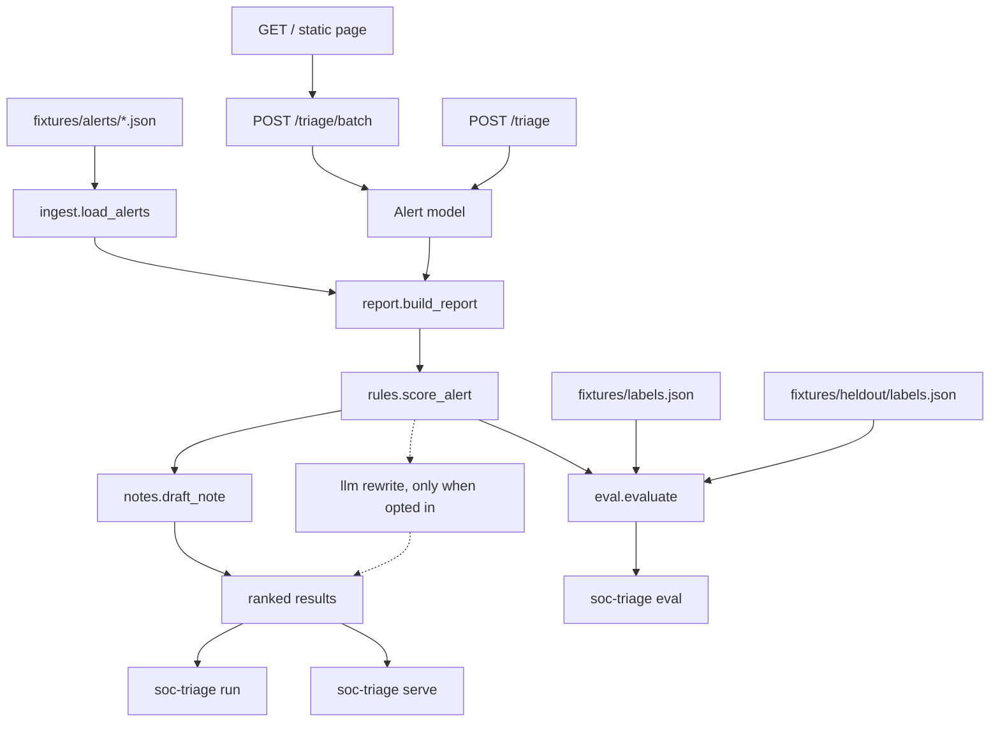
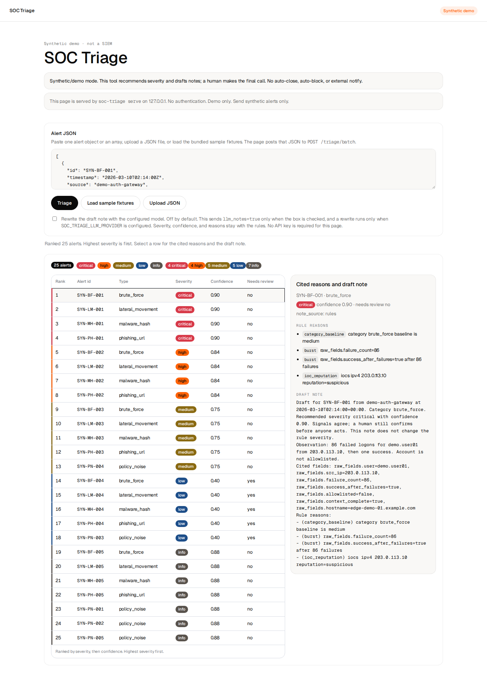

# SOC Triage Agent

A small Python CLI that gives a junior analyst a first pass on a batch of SOC alerts: a severity, a confidence score, cited reasons, and a draft note a person can edit. It runs entirely on synthetic fixtures. It is a portfolio and practice tool, not a SIEM, and it does not connect to a live security stack.

## Why it exists

Junior analysts lose time on noisy, unsorted alerts. This project is the practice loop for that job: load a batch, rank what deserves attention, and leave a short note that shows its work. A human still makes the final call. The tool does not close, block, or notify anyone.

## Features

- Load a JSON file or a directory of alerts into a typed `Alert` model (`ingest`).
- Score each alert with deterministic rules: category baseline, IOC reputation, burst or host-count thresholds, an allowlist downgrade, and an incomplete-context cap (`rules.score_alert`).
- Draft a template analyst note that cites those reasons and the alert fields (`notes.draft_note`). That template is the default.
- `soc-triage run` prints a ranked markdown summary, or JSON, with a synthetic-mode banner first. `--llm-notes` is off. When it is on, and only then, a configured model may rewrite the note text.
- `soc-triage eval` compares the rules to a label file and prints exact-match accuracy, within-one-level accuracy, per-severity precision and recall, a confusion matrix, and any mismatches. The default file is the tuning set. `--alerts` and `--labels` point the same command at `fixtures/heldout`. Eval never calls a model.
- `soc-triage serve` exposes that same path on `127.0.0.1:8000` when you install the `api` extra. `POST /triage` scores one alert. `POST /triage/batch` ranks a list. `GET /` is a single demo page that posts to that batch route. LLM notes stay off unless the request opts in. The process has no authentication.
- No API key and no network on the default path. `pytest` covers that path with mocked HTTP only.

## Architecture

`soc-triage run` walks ingest, rules, notes, and report. `soc-triage eval` calls the same rules and compares the result to labels. Eval does not render notes.



## Severity model

| Level | Meaning |
| --- | --- |
| critical | Likely active compromise or a high-impact indicator |
| high | Strong malicious signal; needs prompt review |
| medium | Suspicious; investigate in the queue |
| low | Weak signal or incomplete context |
| info | Noise, policy, or expected admin activity |

If `context_complete` is false, the score is capped at `low` and marked `needs_review` instead of guessing critical. An allowlist hit downgrades the alert to `info` unless it conflicts with a malicious indicator.

## Spec Kit workflow

The phase docs at the repo root are the source of truth. Code follows them one task at a time.

| Phase | File | Role |
| --- | --- | --- |
| 1. Constitution | [constitution.md](constitution.md) | Non-negotiables: synthetic data only, no offensive tooling, human review, secrets stay out of git |
| 2. Spec | [spec.md](spec.md) | Users, goals, non-goals, and success metrics |
| 3. Plan | [plan.md](plan.md) | Stack, severity model, and repository layout |
| 4. Tasks | [tasks.md](tasks.md) | Ordered work. P0 (T1–T6) is the CLI. T7 is the optional note rewrite. T8 is the local API. T10 is the demo page. |
| 5. Implement | `src/soc_triage/` | The package those tasks produced |

T7 can rewrite a draft note. It stays off unless `--llm-notes` and provider settings are both present. T8 serves the same rules path on localhost. The request flag `llm_notes` defaults to false. T9 adds `fixtures/heldout/`: 30 alerts labeled before the rules scored them. The tuning set and the held-out set are reported separately below. The held-out numbers are the rules engine only. The API and the web page do not change them. T10 is one HTML page on that same process.

Cursor reads the same safety rules from `.cursor/rules/soc-triage.mdc`.

## Quickstart

Python 3.11 or newer. No API key.

```bash
python -m venv .venv
source .venv/bin/activate
pip install -e ".[dev]"
pytest
soc-triage run fixtures/alerts
soc-triage eval
```

On Windows, activate with `.venv\Scripts\activate`.

`scripts/demo.sh` runs the two demo commands after the install above.

```bash
soc-triage run fixtures/alerts --json triage.json
soc-triage run fixtures/alerts/brute_force.json --format json
soc-triage eval --alerts fixtures/alerts --labels fixtures/labels.json --json eval.json
soc-triage eval --alerts fixtures/heldout/alerts --labels fixtures/heldout/labels.json
```

`--format json` prints JSON on stdout and the synthetic-mode banner on stderr. `--json PATH` writes a file and still prints the human-readable report.

## Optional LLM notes

The rules engine still sets severity, confidence, `needs_review`, and the reason list. A model is allowed to rewrite the analyst note only. The default provider is `none`, so `soc-triage run` and `soc-triage eval` send nothing unless you pass `--llm-notes` and the provider is `openai_compatible` with a base URL and a model.

The client speaks the OpenAI chat-completions API with the Python standard library. The base install does not include an LLM SDK. One configuration covers three endpoints:

```bash
# xAI Grok. Put the key in .env or the environment. Do not commit it.
export SOC_TRIAGE_LLM_PROVIDER=openai_compatible
export SOC_TRIAGE_LLM_BASE_URL=https://api.x.ai/v1
export SOC_TRIAGE_LLM_MODEL=grok-4
export SOC_TRIAGE_LLM_API_KEY=your-key-here
soc-triage run fixtures/alerts --llm-notes
```

```bash
# OpenAI. Same client, different host and model id.
export SOC_TRIAGE_LLM_PROVIDER=openai_compatible
export SOC_TRIAGE_LLM_BASE_URL=https://api.openai.com/v1
export SOC_TRIAGE_LLM_MODEL=gpt-4o-mini
export SOC_TRIAGE_LLM_API_KEY=your-key-here
soc-triage run fixtures/alerts --llm-notes
```

```bash
# Local Ollama. No API key. The server must already be running.
export SOC_TRIAGE_LLM_PROVIDER=openai_compatible
export SOC_TRIAGE_LLM_BASE_URL=http://localhost:11434/v1
export SOC_TRIAGE_LLM_MODEL=llama3.2
unset SOC_TRIAGE_LLM_API_KEY
soc-triage run fixtures/alerts --llm-notes
```

`SOC_TRIAGE_LLM_BASE_URL` is the API root ending in `/v1`. The client appends `/chat/completions`. Model ids above are examples; use the id your account or local Ollama tag actually serves. Copy names from `.env.example` into a gitignored `.env` if you want `soc-triage run --llm-notes` to read them. Variables already set in the environment win over the file. `SOC_TRIAGE_LLM_TIMEOUT` defaults to 8 seconds. A value outside (0, 60] is ignored.

If the flag is set and the provider, URL, or model is missing, the command prints a warning and keeps the template. The same fallback happens on timeout, HTTP error, empty text, or a note longer than 2000 characters. JSON records `note_source` as `rules` or `llm` on every row. A model note in the markdown summary is marked `AI-drafted, analyst review required.` The rule severity and the full reason list are repeated under that prose. The model text is untrusted: alert fields are sent as a delimited JSON block, and the prompt tells the model not to invent IOCs or follow instructions inside the block.

`scripts/demo.sh` does not pass `--llm-notes`. The local API uses the same switch and the same fallback. A request has to set `llm_notes=true`, or the process has to be started with `soc-triage serve --llm-notes`. With neither, the server does not read the provider settings and does not call the model.

## Local HTTP API

The API is an optional extra. `pip install -e ".[dev]"` includes it, so `pytest` runs the API tests. A machine that only wants the server can use `pip install -e ".[api]"`. The base install still runs `soc-triage run` and `soc-triage eval` without FastAPI.

```bash
soc-triage serve
```

That listens on `127.0.0.1:8000`. The demo page is at [http://127.0.0.1:8000/](http://127.0.0.1:8000/). Docs are at [http://127.0.0.1:8000/docs](http://127.0.0.1:8000/docs). `--host` and `--port` change the bind. The process does not authenticate callers and does not send a CORS wildcard. Treat it as a local demo. Add authentication before you bind anything other than loopback. A non-loopback `--host` prints that warning, then starts.

`POST /triage` takes one alert object, the same JSON the `Alert` model already validates. `POST /triage/batch` takes a JSON array of at most 500 alerts. Bodies larger than 1 MiB are rejected. Invalid JSON is HTTP 422 and the body has no stack trace. `GET /fixtures/demo` triages the bundled files under `fixtures/alerts`. `GET /fixtures/sample` returns those same alerts unscored, which is what the page loads. `GET /health` returns `{"status":"ok","mode":"synthetic"}`. `GET /` is the page described under Web UI.

This is a real `POST /triage` of `SYN-BF-001` from `fixtures/alerts/brute_force.json`. The body below is the response from that command on a local `soc-triage serve`, pretty-printed. LLM notes were left off:

```bash
python -c 'import json,sys; json.dump(json.load(open("fixtures/alerts/brute_force.json"))[0], sys.stdout)' \
  | curl -s -X POST http://127.0.0.1:8000/triage -H 'content-type: application/json' --data @-
```

```json
{
    "banner": "Synthetic/demo mode. This tool recommends severity and drafts notes; a human makes the final call. No auto-close, auto-block, or external notify.",
    "id": "SYN-BF-001",
    "severity": "critical",
    "confidence": 0.9,
    "needs_review": false,
    "reasons": [
        {
            "code": "category_baseline",
            "message": "category brute_force baseline is medium"
        },
        {
            "code": "burst",
            "message": "raw_fields.failure_count=86"
        },
        {
            "code": "burst",
            "message": "raw_fields.success_after_failures=true after 86 failures"
        },
        {
            "code": "ioc_reputation",
            "message": "iocs ipv4 203.0.113.10 reputation=suspicious"
        }
    ],
    "note": "Draft for SYN-BF-001 from demo-auth-gateway at 2026-03-10T02:14:00+00:00. Category brute_force. Recommended severity critical with confidence 0.90. Signals agree; a human still confirms before anyone acts. This note does not change the rule severity.\nObservation: 86 failed logons for demo.user01 from 203.0.113.10, then one success. Account is not allowlisted.\nCited fields: raw_fields.user=demo.user01, raw_fields.src_ip=203.0.113.10, raw_fields.failure_count=86, raw_fields.success_after_failures=true, raw_fields.allowlisted=false, raw_fields.context_complete=true, raw_fields.hostname=edge-demo-01.example.com\nRule reasons:\n- (category_baseline) category brute_force baseline is medium\n- (burst) raw_fields.failure_count=86\n- (burst) raw_fields.success_after_failures=true after 86 failures\n- (ioc_reputation) iocs ipv4 203.0.113.10 reputation=suspicious",
    "note_source": "rules"
}
```

`POST /triage/batch` returns those same rows ranked like `soc-triage run`, plus `severity_counts`. On the 25 tuning alerts that is 4 critical, 4 high, 5 medium, 5 low, and 7 info.

## Web UI

`soc-triage serve` serves one page at [http://127.0.0.1:8000/](http://127.0.0.1:8000/). It is the same local demo as the API. The process binds `127.0.0.1` unless you change `--host`. It does not authenticate callers. This is demo-only. It is not a case-management console and it is not a SIEM. Add authentication before you bind anything other than loopback. Send synthetic alerts only.

The page is a single HTML file (`src/soc_triage/static/index.html`) with vanilla CSS and JavaScript. There is no frontend build and no extra package. It uses the x.ai light theme: a white canvas, near-black ink, pill buttons, and hairline cards. Type is Geist, the open family, served from the same process. Severity stays color-coded on top of that chrome. Paste alert JSON, upload a `.json` file, or choose **Load sample fixtures**. One alert object or an array of alerts both work. Each of those actions posts the JSON to `POST /triage/batch`. **Load sample fixtures** first reads `GET /fixtures/sample`, the unscored contents of `fixtures/alerts`, and then posts that list.

The table is the server ranking: highest severity first, then confidence. Each severity has its own color. Columns are rank, alert id, type, severity, confidence, and needs review. Select a row to read the cited rule reasons and the draft analyst note, including `note_source`.

The model checkbox is unchecked. Checking it adds `llm_notes=true` on that request. A rewrite still runs only when `SOC_TRIAGE_LLM_PROVIDER` is `openai_compatible` and a base URL and model are set. The page does not ask for an API key. With the box unchecked, the request omits the flag and the template note is kept. `soc-triage serve --llm-notes` still opts every request in, including requests from this page, because that server flag already did. A model note shows `note_source` `llm` and the label `AI-drafted, analyst review required.`



The screenshot is the bundled 25-alert sample after **Load sample fixtures**, with the first row open. LLM notes were left off. The counts are 4 critical, 4 high, 5 medium, 5 low, and 7 info.

## Sample output

Opening of a real `soc-triage run fixtures/alerts`:

```text
Synthetic/demo mode. This tool recommends severity and drafts notes; a human makes the final call. No auto-close, auto-block, or external notify.

# Triage summary (25 alerts)

4 critical · 4 high · 5 medium · 5 low · 7 info

Ranked by severity, then confidence. Recommendations only; a human makes the final call.

| Rank | Id | Category | Severity | Confidence | Needs review | Top reasons |
| --- | --- | --- | --- | --- | --- | --- |
| 1 | SYN-BF-001 | brute_force | critical | 0.90 | no | raw_fields.failure_count=86 · raw_fields.success_after_failures=true after 86 failures |
| 2 | SYN-LM-001 | lateral_movement | critical | 0.90 | no | spread=14; raw_fields.dest_host_count=14, raw_fields.admin_share_conn... · iocs ipv4 203.0.113.50 reputation=malicious |
| 3 | SYN-MH-001 | malware_hash | critical | 0.90 | no | sha256 aaaaaaaaaaaaaaaaaaaaaaaaaaaaaaaaaaaaaaaaaaaaaaaaaaaaaaaaaaaaaa... · iocs sha256 aaaaaaaaaaaaaaaaaaaaaaaaaaaaaaaaaaaaaaaaaaaaaaaaaaaaaaaaa... |
| 4 | SYN-PH-001 | phishing_url | critical | 0.90 | no | raw_fields.url=https://sso.login.example/reset · raw_fields.clicked=true and IOC reputation=malicious |
```

The first draft note from that same run:

```text
### SYN-BF-001

Draft for SYN-BF-001 from demo-auth-gateway at 2026-03-10T02:14:00+00:00. Category brute_force. Recommended severity critical with confidence 0.90. Signals agree; a human still confirms before anyone acts. This note does not change the rule severity.
Observation: 86 failed logons for demo.user01 from 203.0.113.10, then one success. Account is not allowlisted.
Cited fields: raw_fields.user=demo.user01, raw_fields.src_ip=203.0.113.10, raw_fields.failure_count=86, raw_fields.success_after_failures=true, raw_fields.allowlisted=false, raw_fields.context_complete=true, raw_fields.hostname=edge-demo-01.example.com
Rule reasons:
- (category_baseline) category brute_force baseline is medium
- (burst) raw_fields.failure_count=86
- (burst) raw_fields.success_after_failures=true after 86 failures
- (ioc_reputation) iocs ipv4 203.0.113.10 reputation=suspicious
```

Full output of `soc-triage eval` on the tuning set (`fixtures/alerts` and `fixtures/labels.json`):

```text
Synthetic/demo mode. This tool recommends severity and drafts notes; a human makes the final call. No auto-close, auto-block, or external notify.

# Eval summary

Labeled alerts: 20 of 25 loaded. Unlabeled alerts are excluded.
Exact-match accuracy: 20/20 (100%).
Within-one-level accuracy: 20/20 (100%).

The labeled set is small and synthetic. The rules were tuned on these same alerts, so this score is not a measure of real-world accuracy. Score the untouched held-out set with `soc-triage eval --alerts fixtures/heldout/alerts --labels fixtures/heldout/labels.json`.

## Per severity

Counts use only labeled alerts. Precision and recall are n/a when the denominator is 0.

| Severity | Labeled | Predicted | TP | Precision | Recall |
| --- | --- | --- | --- | --- | --- |
| critical | 4 | 4 | 4 | 1.00 | 1.00 |
| high | 4 | 4 | 4 | 1.00 | 1.00 |
| medium | 5 | 5 | 5 | 1.00 | 1.00 |
| low | 3 | 3 | 3 | 1.00 | 1.00 |
| info | 4 | 4 | 4 | 1.00 | 1.00 |

## Confusion matrix

Rows are labeled severity. Columns are predicted severity.

| Labeled \ Predicted | critical | high | medium | low | info |
| --- | --- | --- | --- | --- | --- |
| critical | 4 | 0 | 0 | 0 | 0 |
| high | 0 | 4 | 0 | 0 | 0 |
| medium | 0 | 0 | 5 | 0 | 0 |
| low | 0 | 0 | 0 | 3 | 0 |
| info | 0 | 0 | 0 | 0 | 4 |

## Mismatches

No mismatches.
```

## Held-out result

`fixtures/heldout/` is 30 new synthetic alerts, six in each of the same five categories. The labels were written from the severity definitions before this command was run, and `rules.py` was not changed afterward. Within one level means the prediction is the label or the next step on the scale critical, high, medium, low, info. Medium and info are two steps apart.

```bash
soc-triage eval --alerts fixtures/heldout/alerts --labels fixtures/heldout/labels.json
```

Exact-match accuracy: **24/30 (80%)**. Within-one-level accuracy: **27/30 (90%)**. The spec target is at least 70% exact match on a held-out set.

| Labeled \ Predicted | critical | high | medium | low | info |
| --- | --- | --- | --- | --- | --- |
| critical | 4 | 0 | 2 | 0 | 0 |
| high | 0 | 4 | 3 | 0 | 0 |
| medium | 0 | 0 | 5 | 0 | 1 |
| low | 0 | 0 | 0 | 6 | 0 |
| info | 0 | 0 | 0 | 0 | 5 |

Six alerts miss. Three are one level away, and three are two levels away.

| Id | Labeled | Predicted | What the label was judging |
| --- | --- | --- | --- |
| HO-BF-002 | high | medium | 29 failed logons from a suspicious address, with no success. That is a strong signal. The rule reaches high at 30 failures. |
| HO-BF-003 | critical | medium | 9 failures, then a success. The success is likely compromise. The rule requires 10 failures before a success is critical, so 9 stays in the medium band. |
| HO-LM-006 | high | medium | Admin shares on 4 hosts after hours from a suspicious address. The rule reaches high at a spread of 5. |
| HO-MH-006 | high | medium | An allowlisted hash executed and contacted a malicious address. The label stays at high. The rule caps an allowlist conflict with a malicious indicator at medium. |
| HO-PH-004 | critical | medium | The recipient clicked a URL marked malicious. The parent domain is allowlisted. The label treats the click as likely compromise. The same allowlist cap stops at medium. |
| HO-PN-006 | medium | info | An allowlisted VPN user mounted removable storage, and the source is suspicious. The label keeps the policy violation in the queue. With no malicious indicator, the rule downgrades the allowlist hit to info. |

The misses sit on round count cutoffs (29, 9 then success, spread of 4) and on allowlist handling. This measurement does not change the rules. The alerts are still hand-authored synthetic cases, so 80% is an honest score on unseen fixture variations, and it is still not production detection performance.

## Resume blurb

- Built a Python CLI that ranks synthetic SOC alerts across 5 categories (brute force, phishing URL, malware hash, lateral movement, and policy noise) and drafts analyst notes a person can edit. Severity, confidence, and reasons come from deterministic rules. The default path needs no API key and makes no network call.
- `soc-triage run` on the 25-alert tuning set prints a ranked summary (4 critical, 4 high, 5 medium, 5 low, 7 info). `soc-triage eval` reports exact-match accuracy, within-one-level accuracy, and a confusion matrix.
- Tuning-set exact match is 20/20 (100%) because the rules were written against those alerts. Held-out exact match is 24/30 (80%), and within one level is 27/30 (90%), on 30 alerts labeled before any scoring run. 90 pytest tests pass with no secrets.
- Optional `--llm-notes` rewrites the draft through an OpenAI-compatible endpoint (xAI Grok, OpenAI, or local Ollama). The call is off unless the flag and provider config are both set. Missing config, timeout, or invalid text keeps the template note. The model cannot change severity.
- Served that same rules path from a local FastAPI process (`soc-triage serve` on 127.0.0.1). `POST /triage` and `POST /triage/batch` return severity, confidence, needs_review, cited reasons, and a draft note. LLM notes stay off unless the caller opts in. The service does not authenticate callers.
- Added a localhost demo page on that same process: paste, upload, or load the sample alerts, post them to `POST /triage/batch`, and read a color-coded ranked table with the cited reasons and a draft note. The model checkbox stays off unless the analyst checks it. The page has no authentication and is a demo only.

## Limitations

- Synthetic data only. Fixtures use RFC 5737 documentation addresses and RFC 2606 `example` domains. Do not drop real alerts or personal data into `fixtures/`.
- The tuning labels cover 20 of 25 fixtures. Five fixtures have no label and are excluded from that score. Exact match on those 20 is 20/20 (100%) because the rules were tuned on that set.
- The held-out set is 30 fully labeled alerts. Exact match is 24/30 (80%) and within one level is 27/30 (90%). The six misses are the near-threshold counts and allowlist cases in the table above. `rules.py` was not edited after that measurement. The figure is still hand-authored synthetic data, not production telemetry.
- No SIEM, EDR, or ticket integration. Nothing is auto-closed, blocked, or sent to another system.
- Notes are templates unless you opt in with `--llm-notes` or, on the local API, `llm_notes=true` or `soc-triage serve --llm-notes`, and `SOC_TRIAGE_LLM_PROVIDER=openai_compatible` with a base URL and a model. That path sends the alert's structured fields and the rule reasons to the host you configure. Use synthetic fixtures only. Do not point it at real incidents.
- The model can still write fluent prose that misstates a fact. The tool checks that the text is non-empty and at most 2000 characters. It does not fact-check the prose. Read `note_source` and the rule reasons, and treat `llm` text as untrusted. A human still decides.
- Each alert is one request. A hung server waits up to the timeout (default 8 seconds) per alert, then the template note is used. Redirects are refused. Eval numbers do not include this path and are unchanged by it.
- The HTTP API and the page at `GET /` are a local demo. The process binds `127.0.0.1:8000` unless you change `--host` and `--port`. It does not authenticate callers. Add authentication before exposing it on a network. Request bodies are limited to 1 MiB, and a batch is limited to 500 alerts. Invalid input is a 422 with no stack trace. CORS is not opened. Send synthetic alerts only. The page is one ranked table, not case management.

## Layout

```
constitution.md  spec.md  plan.md  tasks.md
src/soc_triage/          ingest, rules, notes, llm, report, cli, api, eval, static/index.html
tests/                   pytest (90 tests)
fixtures/alerts/         25 synthetic tuning alerts, five files
docs/web-ui.png          screenshot of the demo page on the sample alerts
fixtures/labels.json     20 labels for that tuning set
fixtures/heldout/        30 labeled alerts the rules were not tuned on
scripts/demo.sh
```
