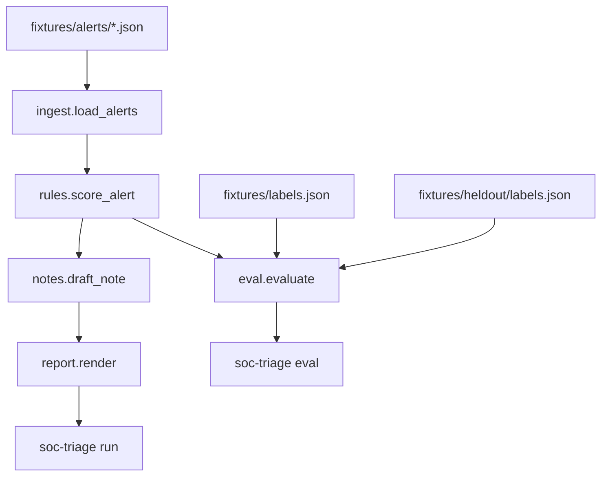

# SOC Triage Agent

A small Python CLI that gives a junior analyst a first pass on a batch of SOC alerts: a severity, a confidence score, cited reasons, and a draft note a person can edit. It runs entirely on synthetic fixtures. It is a portfolio and practice tool, not a SIEM, and it does not connect to a live security stack.

## Why it exists

Junior analysts lose time on noisy, unsorted alerts. This project is the practice loop for that job: load a batch, rank what deserves attention, and leave a short note that shows its work. A human still makes the final call. The tool does not close, block, or notify anyone.

## Features

- Load a JSON file or a directory of alerts into a typed `Alert` model (`ingest`).
- Score each alert with deterministic rules: category baseline, IOC reputation, burst or host-count thresholds, an allowlist downgrade, and an incomplete-context cap (`rules.score_alert`).
- Draft a template analyst note that cites those reasons and the alert fields (`notes.draft_note`). No language-model call.
- `soc-triage run` prints a ranked markdown summary, or JSON, with a synthetic-mode banner first.
- `soc-triage eval` compares the rules to a label file and prints exact-match accuracy, within-one-level accuracy, per-severity precision and recall, a confusion matrix, and any mismatches. The default file is the tuning set. `--alerts` and `--labels` point the same command at `fixtures/heldout`.
- No API key and no network. `pytest` covers the same path.

## Architecture

`soc-triage run` walks ingest, rules, notes, and report. `soc-triage eval` calls the same rules and compares the result to labels. Eval does not render notes.



## Severity model

| Level | Meaning |
| --- | --- |
| critical | Likely active compromise or a high-impact indicator |
| high | Strong malicious signal; needs prompt review |
| medium | Suspicious; investigate in the queue |
| low | Weak signal or incomplete context |
| info | Noise, policy, or expected admin activity |

If `context_complete` is false, the score is capped at `low` and marked `needs_review` instead of guessing critical. An allowlist hit downgrades the alert to `info` unless it conflicts with a malicious indicator.

## Spec Kit workflow

The phase docs at the repo root are the source of truth. Code follows them one task at a time.

| Phase | File | Role |
| --- | --- | --- |
| 1. Constitution | [constitution.md](constitution.md) | Non-negotiables: synthetic data only, no offensive tooling, human review, secrets stay out of git |
| 2. Spec | [spec.md](spec.md) | Users, goals, non-goals, and success metrics |
| 3. Plan | [plan.md](plan.md) | Stack, severity model, and repository layout |
| 4. Tasks | [tasks.md](tasks.md) | Ordered work. P0 (T1–T6) is the CLI in this README |
| 5. Implement | `src/soc_triage/` | The package those tasks produced |

T9 adds `fixtures/heldout/`: 30 alerts labeled before the rules scored them. The tuning set and the held-out set are reported separately below.

Cursor reads the same safety rules from `.cursor/rules/soc-triage.mdc`.

## Quickstart

Python 3.11 or newer. No API key.

```bash
python -m venv .venv
source .venv/bin/activate
pip install -e ".[dev]"
pytest
soc-triage run fixtures/alerts
soc-triage eval
```

On Windows, activate with `.venv\Scripts\activate`.

`scripts/demo.sh` runs the two demo commands after the install above.

```bash
soc-triage run fixtures/alerts --json triage.json
soc-triage run fixtures/alerts/brute_force.json --format json
soc-triage eval --alerts fixtures/alerts --labels fixtures/labels.json --json eval.json
soc-triage eval --alerts fixtures/heldout/alerts --labels fixtures/heldout/labels.json
```

`--format json` prints JSON on stdout and the synthetic-mode banner on stderr. `--json PATH` writes a file and still prints the human-readable report.

## Sample output

Opening of a real `soc-triage run fixtures/alerts`:

```text
Synthetic/demo mode. This tool recommends severity and drafts notes; a human makes the final call. No auto-close, auto-block, or external notify.

# Triage summary (25 alerts)

4 critical · 4 high · 5 medium · 5 low · 7 info

Ranked by severity, then confidence. Recommendations only; a human makes the final call.

| Rank | Id | Category | Severity | Confidence | Needs review | Top reasons |
| --- | --- | --- | --- | --- | --- | --- |
| 1 | SYN-BF-001 | brute_force | critical | 0.90 | no | raw_fields.failure_count=86 · raw_fields.success_after_failures=true after 86 failures |
| 2 | SYN-LM-001 | lateral_movement | critical | 0.90 | no | spread=14; raw_fields.dest_host_count=14, raw_fields.admin_share_conn... · iocs ipv4 203.0.113.50 reputation=malicious |
| 3 | SYN-MH-001 | malware_hash | critical | 0.90 | no | sha256 aaaaaaaaaaaaaaaaaaaaaaaaaaaaaaaaaaaaaaaaaaaaaaaaaaaaaaaaaaaaaa... · iocs sha256 aaaaaaaaaaaaaaaaaaaaaaaaaaaaaaaaaaaaaaaaaaaaaaaaaaaaaaaaa... |
| 4 | SYN-PH-001 | phishing_url | critical | 0.90 | no | raw_fields.url=https://sso.login.example/reset · raw_fields.clicked=true and IOC reputation=malicious |
```

The first draft note from that same run:

```text
### SYN-BF-001

Draft for SYN-BF-001 from demo-auth-gateway at 2026-03-10T02:14:00+00:00. Category brute_force. Recommended severity critical with confidence 0.90. Signals agree; a human still confirms before anyone acts. This note does not change the rule severity.
Observation: 86 failed logons for demo.user01 from 203.0.113.10, then one success. Account is not allowlisted.
Cited fields: raw_fields.user=demo.user01, raw_fields.src_ip=203.0.113.10, raw_fields.failure_count=86, raw_fields.success_after_failures=true, raw_fields.allowlisted=false, raw_fields.context_complete=true, raw_fields.hostname=edge-demo-01.example.com
Rule reasons:
- (category_baseline) category brute_force baseline is medium
- (burst) raw_fields.failure_count=86
- (burst) raw_fields.success_after_failures=true after 86 failures
- (ioc_reputation) iocs ipv4 203.0.113.10 reputation=suspicious
```

Full output of `soc-triage eval` on the tuning set (`fixtures/alerts` and `fixtures/labels.json`):

```text
Synthetic/demo mode. This tool recommends severity and drafts notes; a human makes the final call. No auto-close, auto-block, or external notify.

# Eval summary

Labeled alerts: 20 of 25 loaded. Unlabeled alerts are excluded.
Exact-match accuracy: 20/20 (100%).
Within-one-level accuracy: 20/20 (100%).

The labeled set is small and synthetic. The rules were tuned on these same alerts, so this score is not a measure of real-world accuracy. Score the untouched held-out set with `soc-triage eval --alerts fixtures/heldout/alerts --labels fixtures/heldout/labels.json`.

## Per severity

Counts use only labeled alerts. Precision and recall are n/a when the denominator is 0.

| Severity | Labeled | Predicted | TP | Precision | Recall |
| --- | --- | --- | --- | --- | --- |
| critical | 4 | 4 | 4 | 1.00 | 1.00 |
| high | 4 | 4 | 4 | 1.00 | 1.00 |
| medium | 5 | 5 | 5 | 1.00 | 1.00 |
| low | 3 | 3 | 3 | 1.00 | 1.00 |
| info | 4 | 4 | 4 | 1.00 | 1.00 |

## Confusion matrix

Rows are labeled severity. Columns are predicted severity.

| Labeled \ Predicted | critical | high | medium | low | info |
| --- | --- | --- | --- | --- | --- |
| critical | 4 | 0 | 0 | 0 | 0 |
| high | 0 | 4 | 0 | 0 | 0 |
| medium | 0 | 0 | 5 | 0 | 0 |
| low | 0 | 0 | 0 | 3 | 0 |
| info | 0 | 0 | 0 | 0 | 4 |

## Mismatches

No mismatches.
```

## Held-out result

`fixtures/heldout/` is 30 new synthetic alerts, six in each of the same five categories. The labels were written from the severity definitions before this command was run, and `rules.py` was not changed afterward. Within one level means the prediction is the label or the next step on the scale critical, high, medium, low, info. Medium and info are two steps apart.

```bash
soc-triage eval --alerts fixtures/heldout/alerts --labels fixtures/heldout/labels.json
```

Exact-match accuracy: **24/30 (80%)**. Within-one-level accuracy: **27/30 (90%)**. The spec target is at least 70% exact match on a held-out set.

| Labeled \ Predicted | critical | high | medium | low | info |
| --- | --- | --- | --- | --- | --- |
| critical | 4 | 0 | 2 | 0 | 0 |
| high | 0 | 4 | 3 | 0 | 0 |
| medium | 0 | 0 | 5 | 0 | 1 |
| low | 0 | 0 | 0 | 6 | 0 |
| info | 0 | 0 | 0 | 0 | 5 |

Six alerts miss. Three are one level away, and three are two levels away.

| Id | Labeled | Predicted | What the label was judging |
| --- | --- | --- | --- |
| HO-BF-002 | high | medium | 29 failed logons from a suspicious address, with no success. That is a strong signal. The rule reaches high at 30 failures. |
| HO-BF-003 | critical | medium | 9 failures, then a success. The success is likely compromise. The rule requires 10 failures before a success is critical, so 9 stays in the medium band. |
| HO-LM-006 | high | medium | Admin shares on 4 hosts after hours from a suspicious address. The rule reaches high at a spread of 5. |
| HO-MH-006 | high | medium | An allowlisted hash executed and contacted a malicious address. The label stays at high. The rule caps an allowlist conflict with a malicious indicator at medium. |
| HO-PH-004 | critical | medium | The recipient clicked a URL marked malicious. The parent domain is allowlisted. The label treats the click as likely compromise. The same allowlist cap stops at medium. |
| HO-PN-006 | medium | info | An allowlisted VPN user mounted removable storage, and the source is suspicious. The label keeps the policy violation in the queue. With no malicious indicator, the rule downgrades the allowlist hit to info. |

The misses sit on round count cutoffs (29, 9 then success, spread of 4) and on allowlist handling. This measurement does not change the rules. The alerts are still hand-authored synthetic cases, so 80% is an honest score on unseen fixture variations, and it is still not production detection performance.

## Resume blurb

- Built a Python CLI that ranks synthetic SOC alerts across 5 categories (brute force, phishing URL, malware hash, lateral movement, and policy noise) and drafts analyst notes a person can edit. Severity, confidence, and reasons come from deterministic rules. No API key.
- `soc-triage run` on the 25-alert tuning set prints a ranked summary (4 critical, 4 high, 5 medium, 5 low, 7 info). `soc-triage eval` reports exact-match accuracy, within-one-level accuracy, and a confusion matrix.
- Tuning-set exact match is 20/20 (100%) because the rules were written against those alerts. Held-out exact match is 24/30 (80%), and within one level is 27/30 (90%), on 30 alerts labeled before any scoring run. 53 pytest tests pass with no secrets.

## Limitations

- Synthetic data only. Fixtures use RFC 5737 documentation addresses and RFC 2606 `example` domains. Do not drop real alerts or personal data into `fixtures/`.
- The tuning labels cover 20 of 25 fixtures. Five fixtures have no label and are excluded from that score. Exact match on those 20 is 20/20 (100%) because the rules were tuned on that set.
- The held-out set is 30 fully labeled alerts. Exact match is 24/30 (80%) and within one level is 27/30 (90%). The six misses are the near-threshold counts and allowlist cases in the table above. `rules.py` was not edited after that measurement. The figure is still hand-authored synthetic data, not production telemetry.
- No SIEM, EDR, or ticket integration. Nothing is auto-closed, blocked, or sent to another system.
- Notes are templates. There is no language-model client yet (T7). `.env.example` lists optional variable names for that later work and is not required to run the demo.

## Layout

```
constitution.md  spec.md  plan.md  tasks.md
src/soc_triage/          ingest, rules, notes, report, cli, eval
tests/                   pytest (53 tests)
fixtures/alerts/         25 synthetic tuning alerts, five files
fixtures/labels.json     20 labels for that tuning set
fixtures/heldout/        30 labeled alerts the rules were not tuned on
scripts/demo.sh
```
